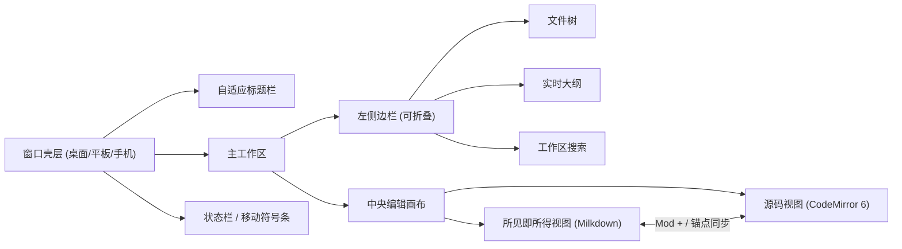
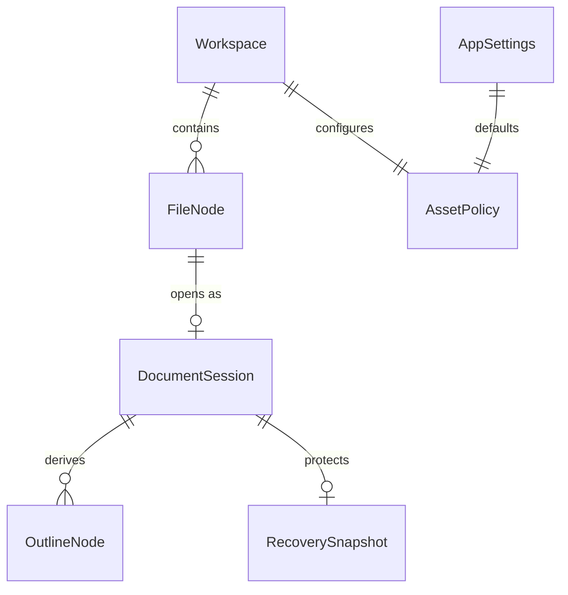
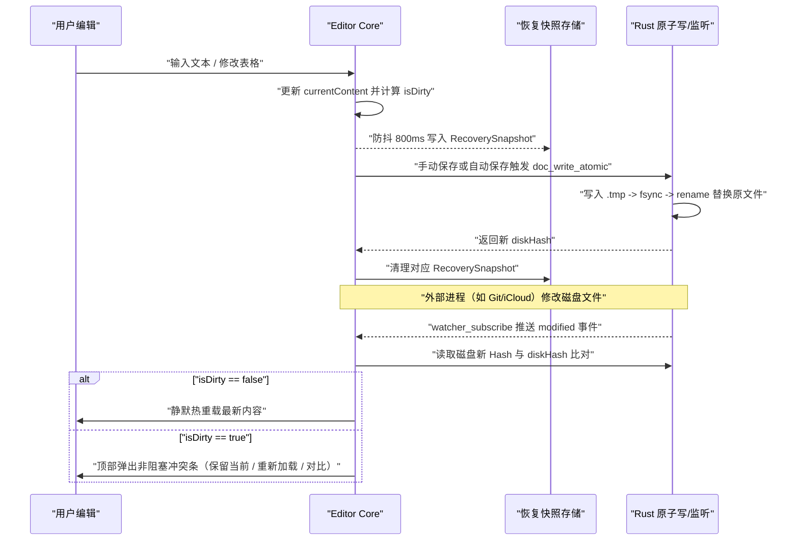

# 跨平台 Typora 风格 Markdown 编辑器详细设计方案

> 本文档面向 **Windows + macOS** 桌面端（P0）与 **iPadOS + iOS** 移动端（P1）协同演进架构，以 **Tauri 2.x** 为跨平台容器，聚焦 **Typora 风格所见即所得（WYSIWYG）+ 即时源码切换** 的核心写作体验。

---

## 1. 产品定位与多端适配策略

### 1.1 核心定位

- **极简沉浸**：默认隐藏冗余工具栏，只保留纸面呼吸感与聚焦光标周围的微交互。
- **本地优先**：文件直接读写本地目录（`.md` 与相对路径 `./assets`），不绑定私有数据库或专有格式，保证 Git 版本控制与多工具互通友好。
- **双模无缝**：日常以所见即所得写作，按下 `Mod + /`（macOS 为 `⌘ + /`，Windows 为 `Ctrl + /`）即时切换纯源码视图，并保持阅读/编辑锚点连续。
- **一次内核，四端适配**：编辑器内核与数据模型 100% 共享，宿主窗口、文件授权与输入辅助条通过平台桥接层按端定制。

### 1.2 四端适配矩阵

| 平台 | 优先级 | 核心形态 | 系统特性 |
| :--- | :--- | :--- | :--- |
| **macOS** | P0 | 原生桌面窗口 | 顶部系统菜单栏、交通灯安全区、iCloud 友好 |
| **Windows** | P0 | 自绘无边框窗口 | Snap Layouts 贴靠、高 DPI 缩放、右键关联 |
| **iPadOS** | P1 | 触控 + 键鼠混合 | 分屏多任务、抽屉侧栏、外接键盘快捷键 |
| **iOS** | P1 | 轻量阅读与速记 | 底部快捷符号条、文档选择器、iCloud 同步 |

### 1.3 推荐技术栈

| 架构层级 | 选型方案 | 核心考量 |
| :--- | :--- | :--- |
| **跨端容器** | Tauri 2.x + Rust | 安装包小、内存低，原生打通桌面与 iOS |
| **前端框架** | React 18 + TS + Vite | 生态成熟；编辑器内核独立，可按需换 Vue 3 |
| **状态管理** | Zustand | 轻量原子化订阅，避免大文档高频输入重渲染 |
| **WYSIWYG 内核** | Milkdown | 基于 ProseMirror + Remark，贴近 Typora 交互 |
| **源码视图** | CodeMirror 6 | 万行长文档流畅滚动，中文输入法兼容性好 |
| **样式方案** | Tailwind + CSS 变量 | 语义化主题切换，零运行时样式开销 |
| **富媒体渲染** | KaTeX + Mermaid + Shiki | 公式即时排版、流程图卡片、代码语法高亮 |

> [!NOTE]
> 前端壳层（React / Vue）仅承载窗口标题栏、侧边栏、弹窗与状态栏；**文档状态机、Markdown AST 往返管线、平台存储适配器** 全部抽离至纯 TypeScript 核心模块，确保后续替换 UI 框架或扩展移动端时零重写。

---

## 2. 界面信息架构与四端交互原型规范

### 2.1 主界面布局与状态流转



### 2.2 四端响应式布局规范

| 终端形态 | 宽度断点 | 侧边栏交互 | 标题栏与工具区 |
| :--- | :--- | :--- | :--- |
| **macOS 桌面** | `>= 1024px` | 左侧常驻推送，支持拖拽调宽 | 左侧预留 78px 交通灯避让区 |
| **Windows 桌面** | `>= 1024px` | 左侧常驻推送，支持快捷键显隐 | 右侧自绘三键，适配 Win11 贴靠 |
| **iPadOS 平板** | `768px - 1023px` | 横屏分栏推送，竖屏悬浮抽屉 | 紧凑顶部导航，支持外接键盘 |
| **iOS 手机** | `< 768px` | 全屏遮罩抽屉，左滑边缘呼出 | 底部贴合软键盘快捷符号条 |

各端原生细节约束如下：

- **macOS 桌面端**：
  - 采用 `titleBarStyle: "Overlay"`，顶部标题栏高度 `38px`，左侧固定预留 `78px` 安全区容纳红黄绿交通灯按钮。
  - 文件树开关与视图切换按钮紧随安全区右侧，空白区域可拖拽移动窗口。
  - 菜单栏交由系统原生顶部菜单承载（文件、编辑、格式、视图、窗口、帮助），关闭最后一个窗口默认保活在 Dock。
- **Windows 11 桌面端**：
  - 启用自定义无边框标题栏（高度 `38px`），左上角展示应用图标与精简菜单入口，右上角放置标准化的最小化、最大化/还原与关闭按钮（单键尺寸 `46px × 38px`）。
  - 最大化按钮接入 Windows 11 Snap Layouts（悬停显示分屏布局提示），全面适配 `100%`–`200%` 系统缩放倍率。
- **iPadOS 平板端**：
  - 适配 Split View / Slide Over 窗口宽度变化；宽度降至 `768px` 以下时自动将侧边栏切换为浮层抽屉，保持正文版心不挤压。
  - 连接妙控键盘时自动显示快捷键提示角标，未连接键盘时在底部激活触控工具条。
- **iOS 手机端**：
  - 隐藏桌面底部状态栏，改用贴合软键盘上方的横向滚动 **快捷符号条**，内置 `#`、`**`、`*`、`` ` ``、`- [ ]`、`表格`、`公式`、`图片`、`撤销/重做` 与 `源码切换`。
  - 顶部仅保留返回文件列表按钮、当前文档标题（点击弹出轻量大纲）与更多菜单。

### 2.3 Typora 风格核心微交互规范

1. **行内语法即时渲染与边界展开**
   - 输入 `**加粗**`、`*斜体*`、`` `行内代码` ``、`[文本](链接)`、`~~删除线~~` 闭合定界符瞬间转为富文本样式。
   - 当光标落入已渲染的行内节点内部时，仅在必要场景（如链接地址、行内公式）展开轻量浮层或揭示语法边界，避免全文闪烁。
2. **块级 InputRules 瞬时转换**
   - 行首输入 `# ` 至 `###### ` 转为 1–6 级标题；`> ` 转为引用块；`- ` / `* ` 转为无序列表；`1. ` 转为有序列表；`- [ ] ` 转为可点击任务项。
   - 输入 `---` 转为分割线；输入 ```` ```lang ```` 回车生成带语言选择器的代码块；输入 `` `$$` `` 回车生成数学公式块。
3. **表格悬浮工具条与键盘导航**
   - 光标进入任意表格单元格时，表格上方淡入极简悬浮工具条：支持 **左/中/右对齐**、**插入/删除行列**、**快速移动列**。
   - 支持 `Tab` 跳至下一单元格、`Shift + Tab` 返回上一单元格；末行末格按 `Tab` 自动追加新行，`Mod + Enter` 跳出表格下方。
4. **公式（KaTeX）与图表（Mermaid）就地卡片**
   - 失焦态下直接以高清晰矢量排版呈现公式或流程图，无多余边框干扰阅读。
   - 单击块体即就地展开 **上下/左右对照面板**（源码输入区 + 实时预览），支持报错行温和提示；点击画布其他区域自动收起回渲染态。
5. **斜杠命令（`/`）与划词极简浮窗**
   - 在空段落输入 `/` 呼出块级命令菜单（支持拼音/英文首字母过滤，如 `/table`、`/math`、`/mermaid`）。
   - 鼠标或触控长按选中文本时，在选区上方出现半透明紧凑浮窗，提供加粗、斜体、删除线、行内代码、链接与高亮 6 个高频动作。
6. **专注模式与打字机模式**
   - **专注模式（Focus Mode）**：非当前光标所在顶级块（段落、列表项、代码块）统一淡化至 `opacity: 0.35`，鼠标悬停可临时恢复清晰度。
   - **打字机模式（Typewriter Mode）**：每次换行或输入后平滑滚动视口，将当前编辑行锚定在窗口垂直约 `45%` 的舒适视线位置。
7. **WYSIWYG ↔ 源码模式锚点映射**
   - 切换模式前记录当前所在块索引（`blockIndex`）与块内字符偏移（`offsetInBlock`）或标题锚点，切换后将目标视图滚动到对应位置并恢复焦点。

---

## 3. 核心数据模型设计

前端使用 TypeScript 作为契约真源（Single Source of Truth），Rust 宿主层通过对应的 `serde::{Serialize, Deserialize}` 结构体（`#[serde(rename_all = "camelCase")]`）保持字段与枚举完全对齐。

### 3.1 实体关系图



### 3.2 核心 TypeScript 模型定义

```typescript
// =========================================================
// 1. 工作区与文件节点模型
// =========================================================
export type PlatformOrigin = 'desktop_path' | 'ios_bookmark' | 'icloud_container';

export interface Workspace {
  id: string;
  name: string;
  /** 桌面端为标准化绝对路径；iOS 为 Security-Scoped Bookmark 映射后的逻辑 URI */
  rootUri: string;
  platformOrigin: PlatformOrigin;
  /** 仅 iOS/iPadOS 持久化目录权限所需的 base64 bookmark */
  securityBookmark?: string;
  expandedDirs: string[];
  lastOpenedAt: number;
}

export interface FileNode {
  id: string;
  name: string;
  /** 相对于工作区根目录的 POSIX 路径，如 "notes/design.md" */
  relativePath: string;
  uri: string;
  kind: 'file' | 'directory';
  ext?: string;
  sizeBytes?: number;
  modifiedAt: number;
  children?: FileNode[];
}

export interface FileWatchEvent {
  workspaceId: string;
  uri: string;
  eventType: 'created' | 'modified' | 'deleted' | 'renamed';
  newUri?: string;
  timestamp: number;
}

// =========================================================
// 2. 文档会话与冲突状态模型
// =========================================================
export type LineEnding = 'LF' | 'CRLF';
export type ViewMode = 'wysiwyg' | 'source';
export type SyncConflictState = 'none' | 'external_modified' | 'external_deleted';

export interface CursorAnchor {
  /** WYSIWYG ProseMirror 文档位置 */
  pmPos: number;
  /** 源码模式行号（1-based）与列号（1-based） */
  line: number;
  column: number;
  /** 用于跨模式切换定位的逻辑块序号 */
  blockIndex: number;
  scrollTopRatio: number;
}

export interface DocumentStats {
  chars: number;
  words: number;
  lines: number;
  readingMinutes: number;
}

export interface DocumentSession {
  docId: string;
  uri: string;
  fileName: string;
  /** 读取或最近一次成功保存时的文件内容 SHA-256，用于冲突判定 */
  diskHash: string;
  /** 打开时的原始文本，用于判断是否真正存在未保存变更 */
  savedContent: string;
  /** 当前内存中的完整 Markdown 文本 */
  currentContent: string;
  isDirty: boolean;
  syncConflict: SyncConflictState;
  eol: LineEnding;
  encoding: 'UTF-8' | 'UTF-8-BOM';
  /** 分离保存的 YAML Frontmatter 原文，避免编辑正文时破坏元数据缩进 */
  frontmatterRaw?: string;
  viewMode: ViewMode;
  cursorAnchor: CursorAnchor;
  stats: DocumentStats;
  lastSavedAt?: number;
}

// =========================================================
// 3. 大纲与工作区检索模型
// =========================================================
export interface OutlineNode {
  id: string;
  level: 1 | 2 | 3 | 4 | 5 | 6;
  text: string;
  slug: string;
  /** WYSIWYG 模式对应的 ProseMirror 节点位置 */
  pos: number;
  /** 源码模式对应的行号（1-based） */
  line: number;
}

export interface SearchHit {
  uri: string;
  relativePath: string;
  fileName: string;
  line: number;
  column: number;
  matchLength: number;
  linePreview: string;
}

// =========================================================
// 4. 图片与本地资产策略模型
// =========================================================
export type AssetStorageStrategy =
  | 'relative_assets'      // ./assets/<filename>
  | 'same_name_folder'     // ./<doc_name>.assets/<filename>
  | 'workspace_assets'     // <workspace>/assets/<filename>
  | 'custom_dir';          // 用户指定相对或绝对目录

export interface AssetPolicy {
  strategy: AssetStorageStrategy;
  customSubDir?: string;
  namingRule: 'timestamp_uuid' | 'original_dedup' | 'hash_short';
  /** 写入 Markdown 时是否强制转为 POSIX 正斜杠 "/"（强烈建议恒为 true） */
  forcePosixPath: boolean;
  /** 本地相对路径引用是否自动编码空格（如 %20） */
  encodeWhitespace: boolean;
  /** 粘贴超大图时可选前端无损/有损压缩上限（0 表示不压缩） */
  maxPasteWidthPx: number;
}

// =========================================================
// 5. 崩溃恢复与历史记录模型
// =========================================================
export interface RecoverySnapshot {
  snapshotId: string;
  docId: string;
  uri: string;
  /** 触发快照时磁盘文件的基准 Hash */
  baseDiskHash: string;
  /** 尚未落盘的草稿完整内容 */
  draftContent: string;
  capturedAt: number;
  appVersion: string;
}

export interface RecentItem {
  uri: string;
  name: string;
  kind: 'file' | 'workspace';
  platformOrigin: PlatformOrigin;
  lastAccessedAt: number;
}

// =========================================================
// 6. 分层配置模型（可同步偏好 vs 本机窗口状态）
// =========================================================
export type ThemeId = 'system' | 'paper-light' | 'warm-sepia' | 'night-slate';

/** 可通过配置文件或 iCloud 跨设备同步的写作偏好 */
export interface AppSettings {
  theme: ThemeId;
  fontSizePx: number;          // 默认 15
  lineHeight: number;          // 默认 1.75
  contentMaxWidthPx: number;   // 默认 800（范围 640 ~ 1080）
  defaultEol: LineEnding;      // 新建文件默认 'LF'
  autoSaveEnabled: boolean;
  autoSaveDelayMs: number;     // 默认 1500
  focusModeDefault: boolean;
  typewriterModeDefault: boolean;
  spellcheckEnabled: boolean;
  assetPolicy: AssetPolicy;
  /** 逻辑快捷键覆盖映射，使用 "Mod+Shift+F" 等平台无关描述 */
  keybindings: Record<string, string>;
}

/** 仅限当前设备本地持久化，不参与跨设备同步 */
export interface LocalMachineState {
  windowBounds: {
    x: number;
    y: number;
    width: number;
    height: number;
    maximized: boolean;
  };
  sidebarVisible: boolean;
  sidebarWidthPx: number;      // 默认 260
  activeSidebarTab: 'files' | 'toc' | 'search';
  lastWorkspaceUri?: string;
  openDocUris: string[];
  activeDocUri?: string;
  recentItems: RecentItem[];
}
```

### 3.3 Rust `serde` 映射要点

- **路径与时间戳**：Rust 侧统一将 `std::time::SystemTime` 转为毫秒级 `u64`/`i64`（Unix Epoch ms），避免跨语言解析 ISO 日期差异。
- **枚举命名**：Rust 枚举使用 `#[serde(rename_all = "snake_case")]`，与 TS 字符串联合类型（如 `'external_modified'`、`'relative_assets'`）保持一字不差。
- **大文件保护**：超过阈值（如 `5 MB`）的 `.md` 文件在 `doc_read` 返回元信息标记 `isLargeFile: true`，前端自动降级以源码模式打开，防止 ProseMirror 解析巨型文本阻塞主线程。

---

## 4. 编辑器无损往返与文件读写安全机制

### 4.1 编辑、崩溃恢复与外部变更冲突链路



### 4.2 Round-trip 无损往返（防止污染 Git Diff）

Typora 类编辑器最常见的问题是“打开别人的 Markdown 文件改了一个字，保存后整篇空行、列表符号全被重排”。本方案采用以下策略规避：

1. **EOL 检测与保真**：`doc_read` 读取字节流时统计 `\r\n` 与 `\n`，记录 `DocumentSession.eol`；保存时严格按原文件换行符写回（仅新建文件默认 `LF`）。
2. **Frontmatter 隔离**：打开文件时由前置解析器剥离顶部的 `--- ... ---` YAML 块并原样暂存至 `frontmatterRaw`，在画布顶部以独立可折叠卡片编辑，保存时直接拼回原文首部，不经 Markdown Serializer 二次格式化。
3. **局部序列化与风格嗅探**：打开文件时记录原文档的风格指纹（无序列表用 `-` 还是 `*`、标题用 `#` ATX 风格、代码块用 ```` ``` ````），配置给 Milkdown `remark-stringify` 插件，减少无关字符改写。
4. **未修改不落盘**：即使开启自动保存，也先比对序列化结果与 `savedContent` 是否完全一致，一致则不触发任何磁盘 I/O。

### 4.3 中文输入法（IME）与富文本粘贴处理

- **IME 保护**：监听 `compositionstart` 与 `compositionend` 事件。在 `isComposing === true` 期间，挂起 ProseMirror InputRules（例如在拼音候选框尚未上屏前不触发 `# `、`*` 等自动转换），上屏结束后再执行一次事务检查，彻底杜绝双拼/五笔吞字或光标跳飞。
- **纯净粘贴管线**：
  - 剪贴板包含图片二进制时：直接调用 `asset_save_image` 落盘，插入 ``（自动保证 POSIX `/` 路径）。
  - 剪贴板包含网页富文本（`text/html`）时：经清洗器剔除内联样式、追踪属性与无意义 `<div>/<span>`，转换为标准 GFM 语法；同时提供 `Mod + Shift + V` 纯文本粘贴快捷键。

---

## 5. Tauri 2.x 跨平台接口契约

### 5.1 统一存储抽象（StorageAdapter）

为兼顾 Windows/macOS 直接文件系统访问与 iPadOS/iOS 沙盒权限模型，Rust 后端定义统一的 `StorageAdapter` trait：

- **桌面端实现（`DesktopFsAdapter`）**：直接基于 `std::fs` + `notify` crate 访问用户授予的文件/文件夹路径，零额外开销。
- **移动端实现（`IosSandboxAdapter`）**：通过 Tauri 2 Mobile Swift 插件桥接 `UIDocumentPickerViewController` 获取目录授权，保存 **Security-Scoped Bookmark** 并在每次读取/写入前调用 `startAccessingSecurityScopedResource()`，原生兼容本地「文件」App 与 **iCloud Drive** 目录。

### 5.2 核心 Tauri Command 契约

| Command 名称 | 功能职责 | 跨端要点 |
| :--- | :--- | :--- |
| `workspace_open` | 选择并注册工作区 | 桌面调用系统对话框；iOS 持久化 Bookmark |
| `fs_list_tree` | 递归扫描目录树 | 自动过滤 `.git`、`node_modules` 等隐藏大目录 |
| `doc_read` | 读取文档与元信息 | 返回文本、SHA-256、EOL 及大文件标记 |
| `doc_write_atomic` | 原子写入文档 | 写临时文件并校验 `expectedHash` 后重命名 |
| `watcher_subscribe` | 监听目录文件变化 | 桌面用 `notify`；iOS 轮询/协调文件访问 |
| `asset_save_image` | 粘贴图片落盘 | 按 `AssetPolicy` 生成目录与 POSIX 相对路径 |
| `search_workspace` | 工作区全文检索 | Rust 并行检索，返回行号与片段，不卡 UI |
| `doc_export_html` | 导出单文件 HTML | 内嵌当前主题 CSS 与离线 SVG/数学样式 |
| `doc_print_pdf` | 导出排版 PDF | 调用系统 WebView 原生打印管线保留矢量清晰 |

### 5.3 本地相对路径图片安全加载方案（`md-asset://` 协议）

Markdown 中常见的 `./assets/架构图.png` 若直接作为相对 URL 交给前端 WebView，在打包后的 `tauri://localhost` 环境下无法解析磁盘路径。解决方案如下：

1. 在 Rust 层注册自定义协议 `md-asset://localhost/<doc_id>/<encoded_relative_path>`。
2. 前端渲染图片节点时，将相对路径结合当前激活文档的 `docId` 改写为 `md-asset://` 请求。
3. Rust 协议处理器根据 `docId` 查出文档所在父目录，**规范化路径并严格校验不得越出授权工作区边界（防路径穿越 `../` 越权读取）**，正确解码中文与空格字符（如 `%20`）后流式返回图片字节流与 MIME 类型。
4. 源码写入与复制文本时仍保持干净的 `./assets/架构图.png`，保证文件在任何第三方编辑器下都能正常打开。

---

## 6. 主题系统与排版 Design Tokens

### 6.1 语义主题变量

通过给窗口容器切换 `data-theme` 属性实现零延迟换肤，预设 3 套内置主题并支持跟随系统自动切换：

| 变量分组 | 纸感浅色 | 暖羊皮纸 | 深夜护眼 |
| :--- | :--- | :--- | :--- |
| **画布背景** | `#FFFFFF` | `#FAF5EB` | `#1A1D24` |
| **侧边栏背景** | `#F7F8FA` | `#F3ECE0` | `#14171D` |
| **正文主色** | `#1F2329` | `#2C2620` | `#D8DEE9` |
| **弱化辅助色** | `#646A73` | `#7A6F63` | `#8892A4` |
| **边框分割线** | `#E5E7EB` | `#E6DEC8` | `#2A303C` |
| **强调主题色** | `#2563EB` | `#B45309` | `#60A5FA` |

### 6.2 双端字体回退链与阅读排版基线

- **Apple 生态（macOS / iPadOS / iOS）**：
  - 正文：`"-apple-system", "PingFang SC", "Hiragino Sans GB", sans-serif`
  - 等宽代码：`"SF Mono", "JetBrains Mono", Menlo, monospace`
- **Windows 生态**：
  - 正文：`"Segoe UI", "Microsoft YaHei UI", "Noto Sans CJK SC", sans-serif`
  - 等宽代码：`"Cascadia Mono", "JetBrains Mono", Consolas, monospace`
- **默认阅读排版基线**：
  - 正文最大行宽 `800px`（约每行 38–42 个汉字），上下留白充裕，左右自适应居中。
  - 正文字号 `15px`（移动端自适应 `16px`），行高 `1.75`，段间距 `0.85em`。
  - 标题层级采用温和字号梯度（`H1: 2.0em`、`H2: 1.5em`、`H3: 1.25em`），`H1`/`H2` 可选底部分割线提示章节节奏。

---

## 7. 推荐工程目录结构与分阶段路线图

### 7.1 推荐工程目录结构

整个项目直接以 `C:\Users\79235\Desktop\templates\person\project\show-worker` 作为根目录：

```text
C:\Users\79235\Desktop\templates\person\project\show-worker/
├── src/                               # 前端应用（React + TS + Tailwind）
│   ├── core/                          # 平台无关纯逻辑层
│   │   ├── models/                    # 本文第 3 节定义的数据模型
│   │   ├── markdown/                  # AST 往返解析、Frontmatter 剥离、粘贴清洗
│   │   └── shortcuts/                 # Mod 映射与逻辑快捷键注册表
│   ├── editor/                        # 编辑引擎封装
│   │   ├── wysiwyg/                   # Milkdown 插件（表格工具条、公式/Mermaid卡片、斜杠菜单）
│   │   └── source/                    # CodeMirror 6 配置与锚点同步
│   ├── services/
│   │   ├── platform/                  # Tauri IPC 调用封装（与 Web Mock 适配器隔离）
│   │   └── store/                     # Zustand 状态（workspace / session / settings）
│   ├── components/                    # TitleBar / Sidebar / StatusBar / MobileToolbar / Modals
│   └── themes/                        # CSS Design Tokens 与排版样式表
└── src-tauri/                         # Tauri 2 Rust 宿主与原生扩展
    ├── capabilities/                  # 最小权限声明（desktop / mobile 分离）
    ├── src/
    │   ├── commands/                  # doc_read / doc_write_atomic / asset_save_image / search
    │   ├── storage/                   # StorageAdapter trait（DesktopFs vs MobileBookmark）
    │   ├── protocol/                  # md-asset:// 自定义协议与路径安全校验
    │   └── watcher/                   # 文件变更监听与防抖聚合
    └── gen/apple/                     # Tauri 生成的 macOS / iOS Xcode 工程扩展（Swift 插件）
```

### 7.2 分阶段迭代路线图

| 阶段 | 目标平台 | 核心交付 | 验收标准 |
| :--- | :--- | :--- | :--- |
| **Phase 0** | Win + macOS | Tauri 2 脚手架、自定义标题栏、文件读写 | 双端正常启动，完成原子保存与主题切换 |
| **Phase 1** | Win + macOS | Typora 所见即所得、源码切换、大纲、图片粘贴 | 满足日常写作，IME 不吞字，不污染 Git diff |
| **Phase 2** | Win + macOS | 表格工具条、公式/图表卡片、搜索、PDF 导出 | 复杂技术文档全流程闭环，双端 CI 打包签名 |
| **Phase 3** | iPadOS + iOS | Swift 文件授权插件、触控工具条、iCloud 目录 | 平板与手机可流畅浏览并编辑同步后的笔记 |
